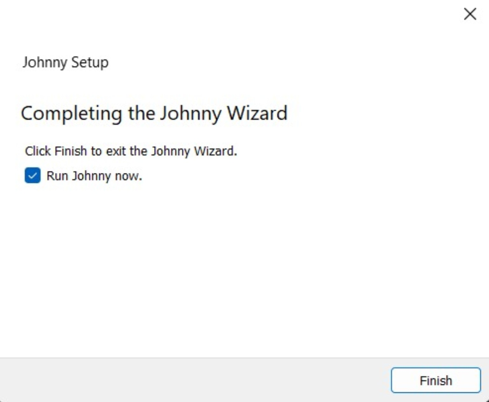
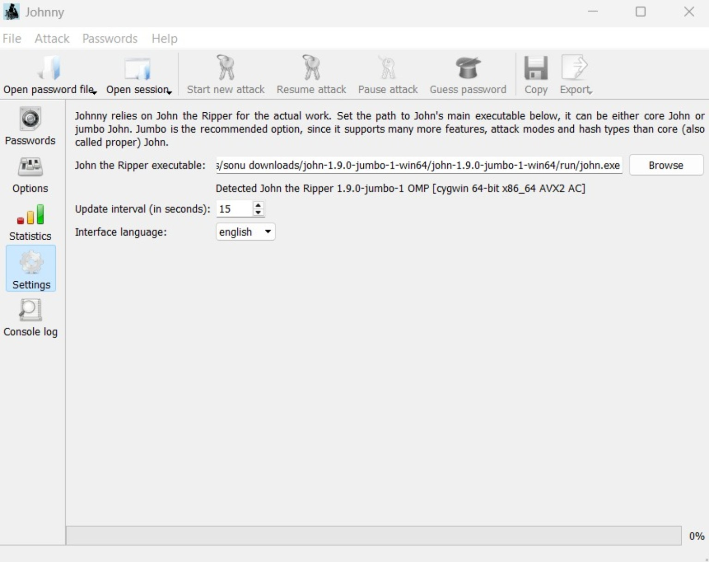
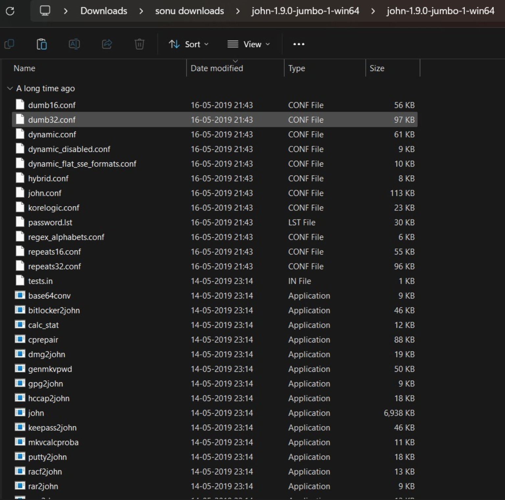
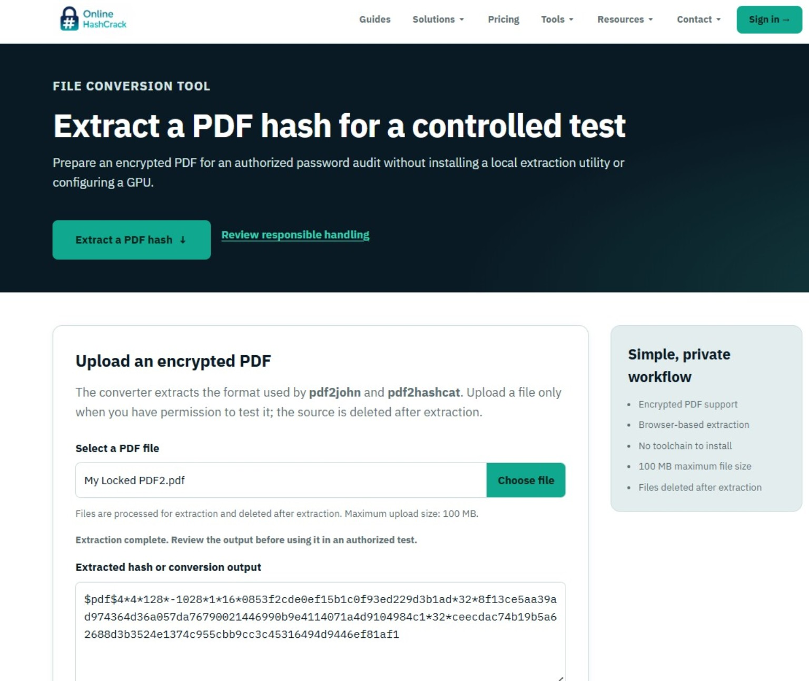
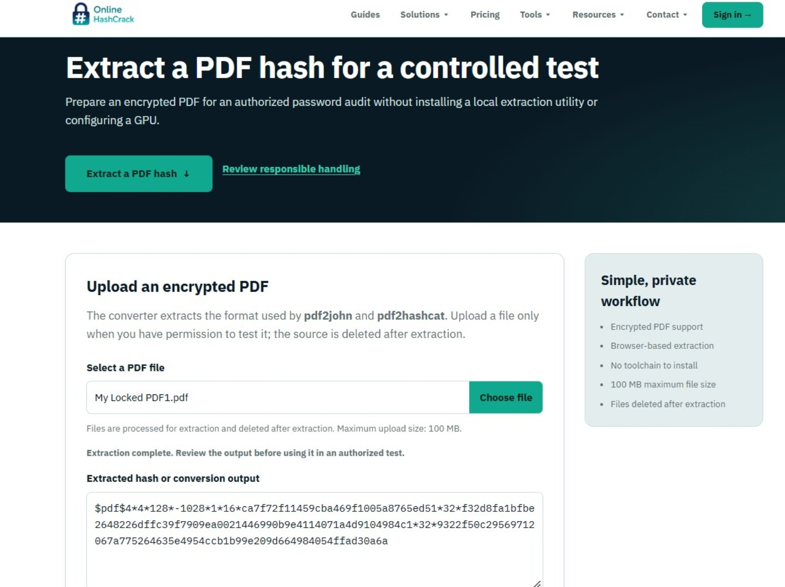
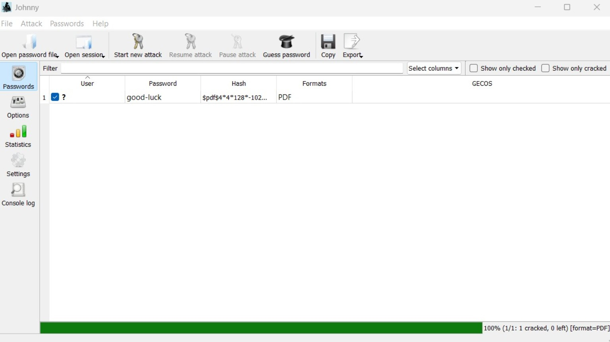
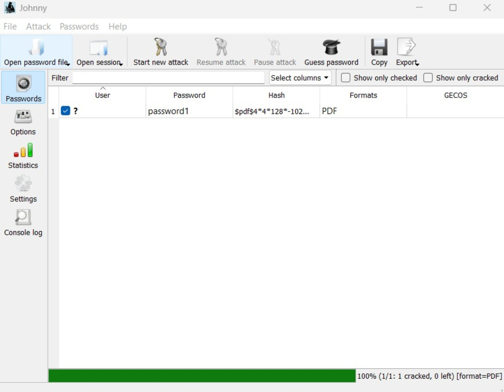

<div align="center">

# PDF Password Auditing Lab

### John the Ripper · Johnny GUI · NetworkWalks Tools

**A documented, evidence-led cybersecurity lab portfolio**

[](docs/)
[](references/SOURCES.md)
[](#repository-quality-checks)
[](SECURITY.md)

[Project Report](docs/Cybersecurity-Lab-Report.pdf) · [Screenshots](screenshots/) · [References](references/SOURCES.md) · [Repository Structure](FOLDER-STRUCTURE.md)

</div>

---

## About this project

This repository documents two guided, hands-on learning modules focused on **auditing password protection on sample PDF documents**. It records the tools, procedures, observations, supplied screenshots, and learning outcomes in a reproducible portfolio format.

The work is organized around two approaches:

| Module | Toolchain | What the guide covers |
|---|---|---|
| **01 — Desktop workflow** | John the Ripper (Jumbo) + Johnny GUI | Configure the desktop tools, extract a PDF hash, load it into Johnny, and run an audit against an authorized sample. |
| **02 — Browser workflow** | NetworkWalks Hash Calculator + Password Cracker | Extract a PDF hash in the browser, submit it to the companion auditing tool, and review its result. |

> **Scope and evidence transparency:** The supplied screenshots document the Johnny/JTR setup and result screens, PDF hash-extraction outputs, and a NetworkWalks flag-capture achievement. They do **not** include dedicated screenshots of the NetworkWalks Hash Calculator and Password Cracker execution. Module 02 is therefore documented from the supplied project guide, not represented as independently screenshot-verified execution. See the [evidence register](docs/EVIDENCE.md).

## Project at a glance

- **Author:** Mohit Dinesh Sonawane
- **Institution:** Sandip Institute of Engineering and Management (SIEM)
- **Programme:** Computer Engineering · Second Year
- **Completion date:** 19 November 2026
- **Project type:** Cybersecurity learning documentation / practical lab portfolio
- **Primary environment:** Windows desktop and web browser

## Contents

- [Learning objectives](#learning-objectives)
- [Tools and environment](#tools-and-environment)
- [Lab 01 — John the Ripper and Johnny](#lab-01--john-the-ripper-and-johnny)
- [Lab 02 — NetworkWalks tools](#lab-02--networkwalks-tools)
- [Screenshots and evidence](#screenshots-and-evidence)
- [Repository layout](#repository-layout)
- [Repository quality checks](#repository-quality-checks)
- [Learning outcomes](#learning-outcomes)
- [Responsible use](#responsible-use)
- [References](#references)

## Learning objectives

1. Explain the purpose of password auditing in an authorized security assessment.
2. Understand the role of a PDF password hash in an offline auditing workflow.
3. Configure John the Ripper Jumbo and its Johnny graphical interface as described in the supplied guide.
4. Follow the documented browser-based workflow using NetworkWalks tools.
5. Interpret tool output while distinguishing observed evidence from steps described only in a guide.
6. Recognize why strong, unique passwords and permission-based testing matter.

## Tools and environment

| Tool / resource | Role in the learning modules |
|---|---|
| [John the Ripper (Jumbo)](https://www.openwall.com/john/) | Password-auditing engine used in the desktop workflow. |
| [Johnny GUI](https://openwall.info/wiki/john/johnny/) | Graphical interface used to configure and operate John the Ripper. |
| [NetworkWalks Hash Calculator](https://networkwalks.com/hash-calculator/) | Browser-based PDF hash extraction step described in Module 02. |
| [NetworkWalks Password Cracker](https://networkwalks.com/password-cracker/) | Browser-based auditing step described in Module 02. |
| Windows PC and web browser | Environment described in the supplied learning materials. |

## Lab 01 — John the Ripper and Johnny

**Aim:** Follow the supplied Week 3 Project Module 1 guide to audit an authorized sample PDF using John the Ripper and Johnny on Windows.

### Workflow

1. Obtain John the Ripper Jumbo from the Openwall source referenced by the guide.
2. Install and launch Johnny GUI.
3. In Johnny settings, point the executable configuration to `john.exe` in the JTR package's `run` directory.
4. Use an authorized sample encrypted PDF for the exercise.
5. Extract its PDF hash using the extraction service referenced in the supplied guide.
6. Copy the complete hash. The guide identifies the PDF hash format by its `$pdf$` prefix; remove unrelated prefix characters if they appear before it.
7. Save the hash as a plain-text file, for example `hash1.txt`.
8. In Johnny, open the password file and select the saved hash file.
9. Start a new attack and review the result displayed by Johnny.
10. Where applicable, verify the candidate by opening the same authorized sample PDF.

### Practical notes

- An incorrectly configured executable path can prevent Johnny from invoking John the Ripper.
- The hash must be copied completely and kept in the expected format.
- The guide notes that audit duration depends on password complexity and computer performance.
- A displayed candidate and a successful PDF-open verification are different evidence points; do not claim the latter unless it was actually observed.

## Lab 02 — NetworkWalks tools

**Aim:** Follow the supplied Week 3 Project Module 2 guide for the browser-based PDF password-auditing workflow.

### Workflow described by the supplied guide

1. Obtain the authorized sample PDF from the [NetworkWalks project task](https://networkwalks.com/project-task-lab-password-cracking-with-networkwalks-tools/).
2. Open the [NetworkWalks Hash Calculator](https://networkwalks.com/hash-calculator/).
3. Upload the sample PDF and allow the tool to extract its hash.
4. Copy the complete hash, ensuring the `$pdf$` portion and remaining content are preserved.
5. Open the [NetworkWalks Password Cracker](https://networkwalks.com/password-cracker/).
6. Submit the extracted hash and start the audit.
7. Wait for the tool's result, then follow the guide's suggested verification step using the authorized sample PDF.

**Evidence status:** This procedure is included because it appears in the supplied Module 02 guide. The screenshot set provided for this repository does not contain dedicated captures of these two NetworkWalks tool screens. The NetworkWalks flag-capture image is retained as a separate achievement image and is not presented as proof of the PDF audit workflow.

## Screenshots and evidence

The following images were supplied for the project record. Captions describe what each image is intended to document; they do not imply evidence beyond what is visible.

<details open>
<summary><strong>01 · Johnny setup and configuration</strong></summary>

| Setup wizard | Executable configuration |
|---|---|
|  |  |

[Open setup image](screenshots/01-johnny-setup.jpg) · [Open configuration image](screenshots/02-johnny-configuration.jpg)
</details>

<details>
<summary><strong>02 · John the Ripper package and PDF hash outputs</strong></summary>

| JTR package folder | PDF hash sample 1 | PDF hash sample 2 |
|---|---|---|
|  |  |  |

[Open JTR folder image](screenshots/03-john-ripper-run-folder.jpg) · [Open hash sample 1](screenshots/04-pdf-hash-sample-1.jpg) · [Open hash sample 2](screenshots/05-pdf-hash-sample-2.jpg)
</details>

<details>
<summary><strong>03 · Johnny audit result screens</strong></summary>

| Result screen 1 | Result screen 2 |
|---|---|
|  |  |

[Open result image 1](screenshots/06-johnny-audit-result-1.jpg) · [Open result image 2](screenshots/07-johnny-audit-result-2.jpg)
</details>

<details>
<summary><strong>04 · NetworkWalks achievement image</strong></summary>


This is retained as an achievement image only; it is not evidence of the Module 02 PDF hash extraction or password-auditing screens.
</details>

For a concise item-by-item record, see [Evidence Register](docs/EVIDENCE.md). For the compiled report, see [`docs/Cybersecurity-Lab-Report.pdf`](docs/Cybersecurity-Lab-Report.pdf).

## Repository layout

```text
.
├── .github/
│   └── workflows/
│       └── repository-checks.yml
├── docs/
│   ├── Cybersecurity-Lab-Report.pdf
│   ├── EVIDENCE.md
│   └── README.md
├── references/
│   └── SOURCES.md
├── screenshots/
│   ├── 01-johnny-setup.jpg
│   ├── 02-johnny-configuration.jpg
│   ├── 03-john-ripper-run-folder.jpg
│   ├── 04-pdf-hash-sample-1.jpg
│   ├── 05-pdf-hash-sample-2.jpg
│   ├── 06-johnny-audit-result-1.jpg
│   ├── 07-johnny-audit-result-2.jpg
│   └── 08-networkwalks-flag-achievement.jpg
├── scripts/
│   └── validate_repo.py
├── .gitignore
├── CHANGELOG.md
├── CONTRIBUTING.md
├── FOLDER-STRUCTURE.md
├── README.md
└── SECURITY.md
```

## Repository quality checks

A lightweight validation script checks that required project assets exist, the PDF is readable at the file-signature level, and local Markdown links and embedded images point to files in this repository.

Run locally with Python 3:

```bash
python scripts/validate_repo.py
```

The same check runs automatically through GitHub Actions when changes are pushed or a pull request is opened. This validates repository structure and local references; it does **not** independently validate the external tools, reproduce the lab, or verify the contents of third-party websites.

## Learning outcomes

- Gained exposure to the purpose and workflow of PDF password auditing.
- Practiced configuring John the Ripper through the Johnny GUI.
- Examined PDF hash extraction outputs and the `$pdf$` format referenced by the guides.
- Reviewed a second, browser-based workflow using NetworkWalks tools.
- Learned to distinguish screenshots of observed activity from procedures documented in a guide.
- Reinforced the importance of strong passwords, authorization, and careful evidence handling.

## Responsible use

This repository is for **education and authorized security testing only**. Use the techniques only with documents you own or have explicit permission to assess. Do not upload confidential, personal, or third-party PDFs to online services without appropriate authorization and an understanding of their data-handling practices. Do not publish recovered passwords, private documents, or sensitive hash material.

Read [SECURITY.md](SECURITY.md) for the project's security and responsible-disclosure position.

## References

- [John the Ripper — Openwall](https://www.openwall.com/john/)
- [Johnny GUI — Openwall Wiki](https://openwall.info/wiki/john/johnny/)
- [NetworkWalks — Project Task](https://networkwalks.com/project-task-lab-password-cracking-with-networkwalks-tools/)
- [NetworkWalks — Hash Calculator](https://networkwalks.com/hash-calculator/)
- [NetworkWalks — Password Cracker](https://networkwalks.com/password-cracker/)
- Supplied learning material: *Week 3 — Project Module 1: Password Cracking with JTR*.
- Supplied learning material: *Week 3 — Project Module 2: Password Cracking with NetworkWalks Tools*.

See [`references/SOURCES.md`](references/SOURCES.md) for the reference list and source notes. The original training PDFs are not redistributed in this repository.

---

<div align="center">

**Documented by Mohit Dinesh Sonawane**  
Computer Engineering · SIEM · 19 November 2026

*Built as a learning record. Used responsibly.*

</div>
